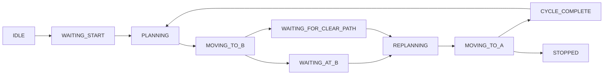

# Patrol scheduling

Default settings are in `configs/patrol_schedule.json`: start delay 5 s, dwell at B 10 s, rest after a complete A→B→A cycle 5 s (changed from 120 s on 2026-11-10), repeat enabled, max cycles 10 (0 still means unlimited), movement timeout 180 s, blocked-path timeout 60 s, simulation clock. UI still accepts 60, 90, 120 seconds or other finite nonnegative intervals. No catch-up cycles are generated.

Max Cycles = 10 means ten complete returns, with Repeat enabled. It does not remove the rest interval. The panel shows completed/limit, Repeat and remaining wait with clock units and approximate real-time duration. `Apply schedule / speed (while waiting)` applies edits in IDLE, STOPPED or CYCLE_COMPLETE. A changed interval is measured from the original arrival at A, so shortening an already expired interval starts the next cycle on the next update without clearing the completed count. Stop first to change clock modes. Explicit saved configurations keep their own interval when loaded.

Typical transitions:

PAUSED, STOPPED and FAULT can interrupt active states. Maximum Cycles counts completed A→B→A returns, not individual legs. The rest interval starts only after arrival at A has passed position, optional heading and actual-speed settle checks. Arrival at B similarly precedes its dwell timer. A new leg cannot overlap the current one.

Simulation clock derives from completed physics/control steps. Timeline Pause freezes it. Explicit patrol Pause while physics continues preserves remaining simulation-time wait when Resume is requested. Wall clock uses `time.perf_counter()` and continues during timeline Pause, but no policy/physics step is issued while paused. An expired wall-time wait can advance only after explicit Resume and fresh path validation; missed intervals do not create a backlog.

Movement deadlines span the whole leg, including replans, rather than restarting every time A* is called. Explicit user Resume starts a fresh validated leg budget. Obstacle waiting uses its own persistent timestamp and cannot be indefinitely renewed by unsuccessful replan attempts. Loss of progress or excessive deviation causes latched FAULT. Return-to-A is a separate one-way request and does not count a new patrol cycle.

The scheduler has no `sleep()` calls. Kit handles display pacing in the application loop. Rendering below 50 wall-clock FPS slows simulation-time scheduling relative to real time; it does not change the 200 Hz physics / 50 Hz policy ratio. Choose wall time if real-clock waiting intervals are desired, while retaining all motion/safety gates.

Logs: `logs/patrol_runs/<run_id>/telemetry.jsonl` contains transitions, timestamps, clock mode, cycle count/duration, robot pose, heading, selected command, actual velocity, goal, path deviation, obstacle clearance, scene updates and performance samples. `scene_map.json` preserves the initial ground-truth collider data and map config. These are local simulation logs and are excluded from Git.
