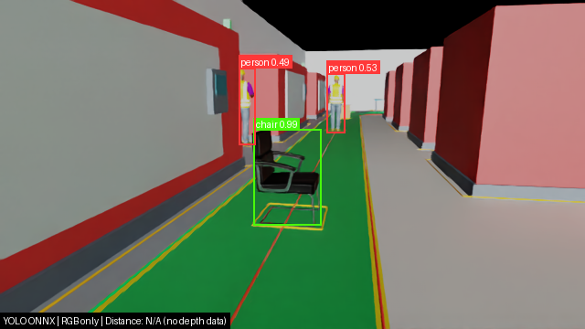
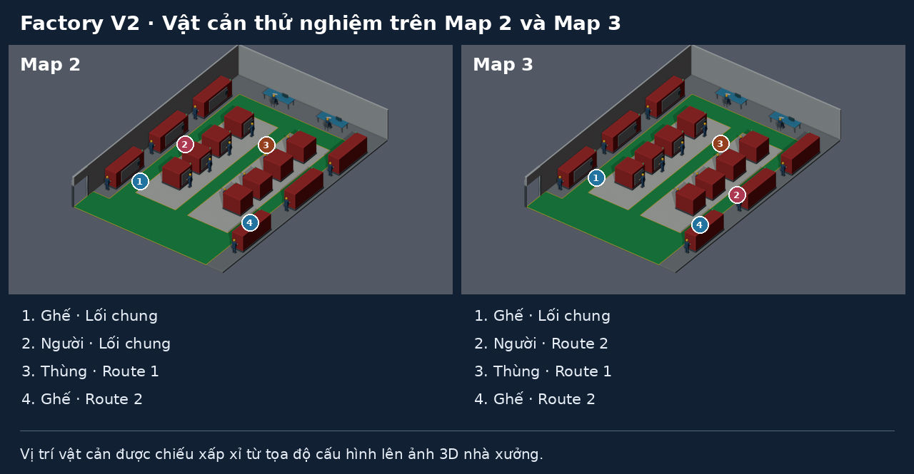
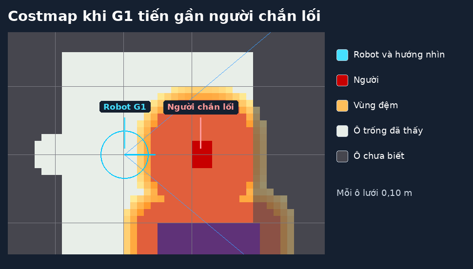
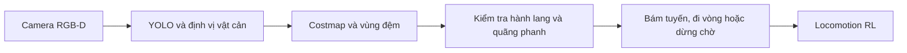

# Unitree G1 nhận diện và né vật cản trong Factory V2

## 1. Từ camera đến vị trí vật cản

- Camera đầu thu ảnh RGB và dữ liệu độ sâu.
- YOLO nhận diện bốn lớp **người, ghế, bàn và thùng**, trả về khung phát hiện và độ tin cậy.
- Hệ thống kết hợp khung phát hiện, độ sâu và tư thế camera để ước tính vị trí vật cản trong nhà xưởng.

*YOLO ONNX chạy trực tiếp trên chính ảnh mẫu `001_map2_chair_1_aug.png`. Các khung hiển thị lớp và độ tin cậy. Ảnh mẫu chỉ có RGB, nên khoảng cách RGB-D chưa có số đo.*

**Lời trình bày:** “YOLO xác định vật thể trong ảnh. Dữ liệu độ sâu giúp xác định vị trí của vật cản để bộ điều hướng kiểm tra đường đi.”

---

## 2. Hiệu năng YOLO chạy trực tiếp trên Map 2

| Chỉ số | Kết quả |
|---|---:|
| Tần suất xử lý trung bình | **4,90 Hz** |
| Độ trễ trung bình từ lúc gửi ảnh đến lúc nhận kết quả | **53,5 ms** |
| Thời gian nhanh nhất từ lúc gửi ảnh đến lúc nhận kết quả | **8,57 ms** (lượt GPU) |
| Thời gian chậm nhất từ lúc gửi ảnh đến lúc nhận kết quả | **888,29 ms** (lượt GPU) |

*Mỗi map có hai ghế, một người và một thùng. Người đứng ở lối chung trong Map 2 và ở Route 2 trong Map 3. Các dấu số thể hiện vị trí xấp xỉ từ cấu hình hiện tại trên ảnh 3D có sẵn của nhà xưởng.*

**Lời trình bày:** “Hệ thống trả về gần năm kết quả nhận diện mỗi giây trong lượt kiểm tra. Độ trễ 53,5 ms đo từ lúc gửi ảnh đến lúc nhận kết quả YOLO. Thời gian từ lúc phát hiện đến lúc robot đổi hướng cần đo trong một lượt tuần tra.” [Điều kiện và kết quả kiểm thử](dynamic_avoidance.md#kiểm-thử)

---

## 3. Bộ điều hướng chọn phương án đi vòng

**Costmap** là lưới 2D quanh robot, cập nhật từ camera RGB-D khi robot di chuyển. Ô đã quan sát thấy trống có chi phí thấp. Ô chứa vật cản và các ô xung quanh có chi phí cao để chừa khoảng đệm cho thân robot và độ lệch khi bước. Ô thiếu dữ liệu hoặc có dữ liệu quá hạn được coi là chưa biết. Bộ điều hướng dùng lưới này để kiểm tra cả đường đi dự kiến và khoảng trống cần để phanh.

*Tình huống minh họa được dựng bằng bộ hiển thị costmap của dự án với dữ liệu tổng hợp. G1 đã tiến đến gần người chắn lối và đang hướng về vùng đệm. Bộ điều hướng kiểm tra vùng đệm phía trước và khoảng trống hai bên để quyết định có thể đi vòng hay cần giảm tốc, dừng chờ.* [Bài kiểm thử costmap](../../tests/test_local_costmap.py)

1. Đưa vật cản đã định vị vào **bản đồ chi phí cục bộ (costmap)** và thêm vùng đệm.
2. Khi hướng bám tuyến bị chặn, thử giảm tốc hoặc đi lệch trái/phải. Kiểm tra từng phương án theo biên hành lang, diện tích robot chiếm chỗ và quãng phanh dự kiến.
3. Đi vòng khi tìm được phương án an toàn. Khi đoạn tuyến thông thoáng, ưu tiên nhập lại tuyến để đến checkpoint kế tiếp. Dừng chờ nếu không có phương án đi tiếp an toàn.

**Lời trình bày:** “Bộ điều hướng đánh giá cả hành lang robot sẽ đi qua và khoảng trống cần để phanh. Sau khi vượt vật cản, robot có thể trở lại tuyến và tiếp tục đúng thứ tự checkpoint.” [Hành vi của bộ điều hướng](dynamic_avoidance.md#hành-vi)

---

## 4. Kết quả kiểm thử logic

| Kịch bản trên dữ liệu tổng hợp | Kết quả |
|---|---|
| Chỉ có khoảng trống bên trái | Chọn lệnh lệch trái |
| Chỉ có khoảng trống bên phải | Chọn lệnh lệch phải |
| Hành lang bị chặn hoàn toàn | Không chọn lệnh đi tiếp |
| Robot đang lệch khỏi Route 1 hoặc Route 2 | Chọn lệnh đưa robot tiến gần lại đoạn tuyến |
| Dữ liệu camera vắng, hết hạn hoặc độ sâu không hợp lệ | Từ chối dữ liệu |

**Lời trình bày:** “Các bài kiểm thử xác nhận lệnh được chọn ở từng tình huống. Bài nhập tuyến kiểm tra một quyết định tại vị trí robot đang lệch tuyến.” [Bảng kiểm thử logic](dynamic_avoidance.md#kiểm-thử)

---

## 5. Đánh giá một lượt né hoàn chỉnh trong PhysX

Báo cáo kiểm thử hiện tại ghi nhận lượt khởi động và xử lý YOLO tại ENTRY. Ba chỉ số dưới đây cần được ghi từ một lượt robot tuần tra và đi vòng qua vật cản.

| Chỉ số | Cách đo |
|---|---|
| **Thời gian phản ứng** | Từ lúc hệ thống xác định vật cản chắn tuyến đến lúc robot bắt đầu giảm tốc hoặc đổi hướng |
| **Khoảng hở nhỏ nhất** | Khoảng cách gần nhất giữa thân robot và vật cản trong đoạn đi vòng |
| **Quỹ đạo thực tế trong mô phỏng** | Vẽ vị trí robot theo thời gian trên tuyến gốc để xác định đoạn rời tuyến, đi vòng và nhập lại |

Khi có video demo, dùng ba khung hình **tiếp cận → đi vòng → nhập lại tuyến** và ghi kèm map, tuyến, tốc độ cài đặt, loại vật cản. Log dự kiến nằm ở `logs/patrol_runs/<run>/telemetry.jsonl`.

**Lời kết:** “Dự án đã tích hợp nhận diện trực tiếp và kiểm thử logic chọn hướng né. Một lượt tuần tra có ghi quỹ đạo sẽ bổ sung bằng chứng định lượng cho toàn bộ thao tác đi vòng.” [Phạm vi kết quả đã ghi nhận](dynamic_avoidance.md#kiểm-thử)
